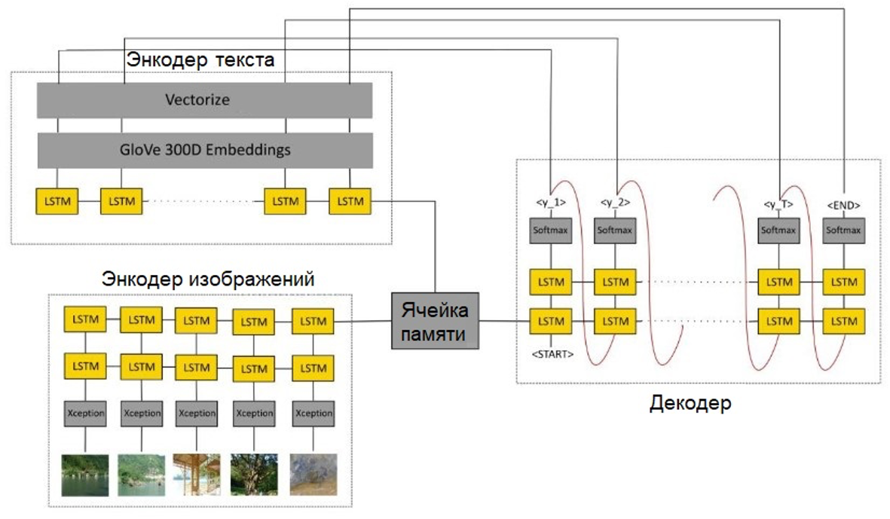
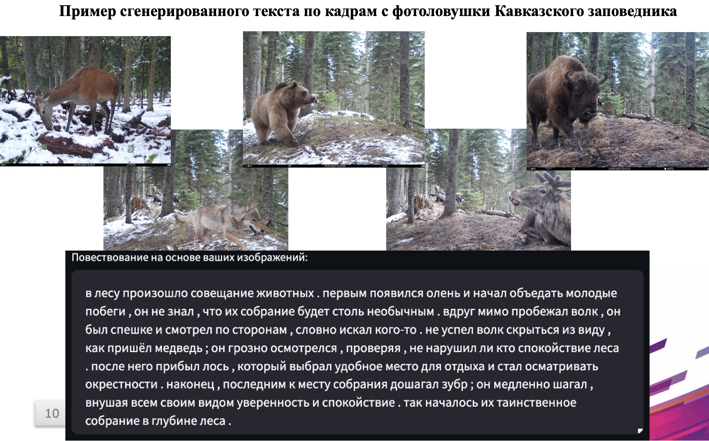
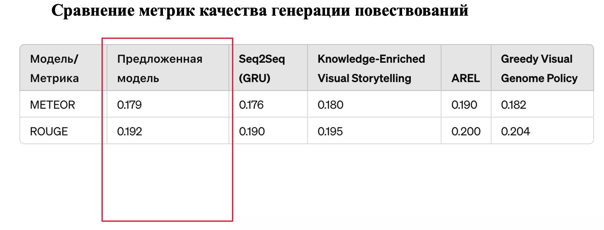

[🇬🇧 English](README.md) | [🇷🇺 Русский](README.ru.md)

Hi, I'm Natali Antro. This is my project, IMG_Story! 
<p>
<a href="https://image-story-b36fb7a799d2.herokuapp.com/" target="_blank">
    
</a>

The original hosted demo is currently unavailable.

<p>
<i>Developed as part of my master's thesis.</i>
<p>

## Developing and evaluating computer vision algorithms for automated storytelling from image sequences

<p>

<p>

## Dataset

The project uses VIST (Visual Storytelling), a dataset of over 80,000 unique photos grouped into more than 20,000 sequences. The data was normalized and preprocessed to improve model training.

<p>

<a href="https://visionandlanguage.net/VIST/dataset.html" target="_blank">
    
</a>

## Model development

### Core architecture

The model uses a Sequence-to-Sequence (Seq2Seq) architecture with LSTM layers to incorporate context from preceding images and text as it generates a story. It consists of three main components: a text encoder, an image encoder, and a decoder.



### Text encoder

- **Text representation:** GloVe maps words to 300-dimensional vectors.
- **Sequence processing:** Multiple LSTM layers process the word vectors in sequence and retain contextual information.

### Image encoder

- **Feature extraction:** A pretrained Xception model extracts visual features such as shapes and textures.
- **Sequence processing:** Multiple LSTM layers process the extracted features in sequence and capture relationships between images.

### Decoder

- **Context retention:** A memory cell receives the combined text and image features and retains context for the full sequence.
- **Text generation:** Multiple LSTM layers generate text by predicting the next word from the context.
- **Activation function:** Each LSTM output layer feeds a softmax activation that selects the most probable next word.


[](https://git.io/typing-svg)

 

## Results

### Main findings

- **Improved contextual coherence:** The LSTM-based Seq2Seq model outperformed GRU-based models on METEOR and ROUGE, indicating an improvement in generated text quality.


- **Model efficiency:** The proposed model performed comparably to the more complex Greedy and AREL approaches while keeping the architecture simpler.



```python
 class WhoAmI:
    user = 'NataAntro'
    current_adventure = ('URFU Student', 'AI/ML Engineer', 'QA Specialist (BaccaSoft)',
			 'Metaverse Researcher', 'Digital artist')
    passions = [
        'Music',
        'Snowboarding',
        'Reading Pelevins books',
        'Gathering many good ideas into one great idea'
    ]

    @independent_method
    def home_base():
        return 'Moscow_Russia'

    @independent_method
    def on_agenda():
        return ['LearnAIandML', 'CreateStartUp', 'LiveinHappiness']
        # Assume 10 more awesome ambitions here  ;)


 ```
